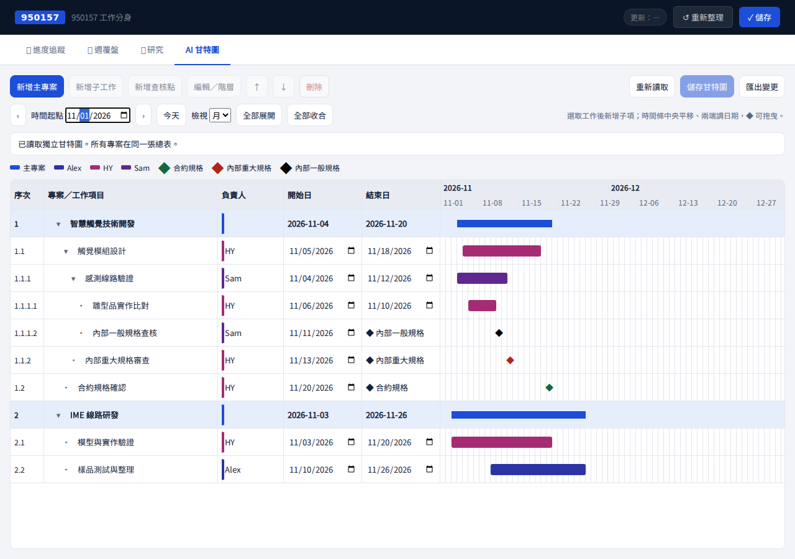
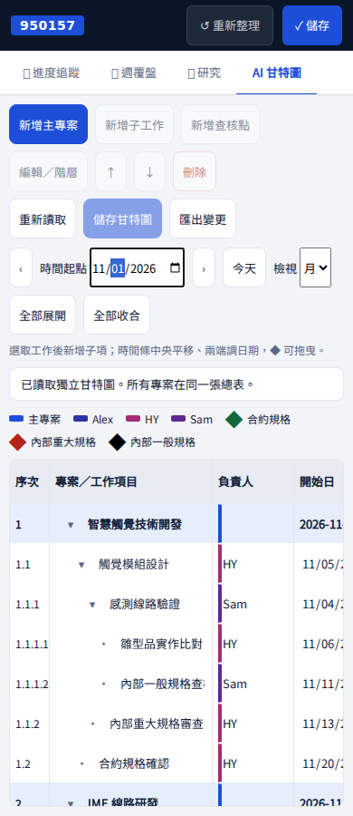
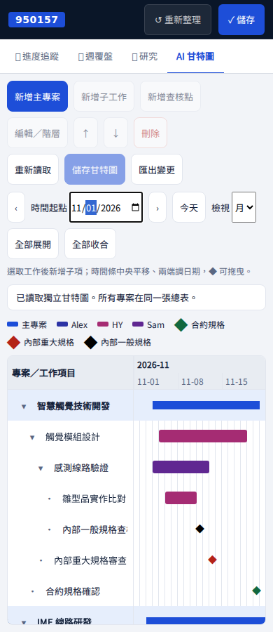
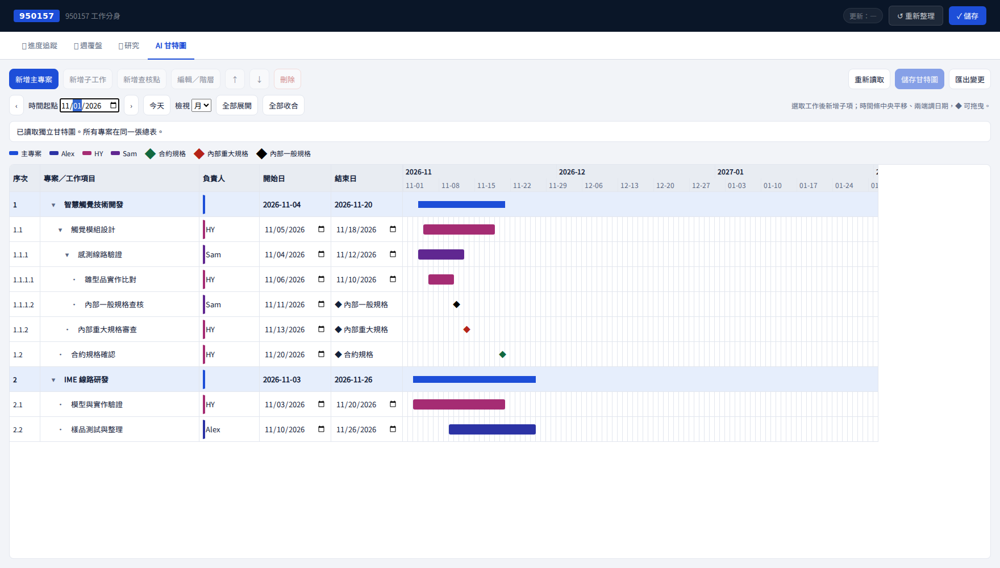

# 950157 AI 甘特圖 MVP（獨立運作）

## 畫面規劃與風格 A 自評

主要工作：在同一張總表查看、編輯多專案排程及三種查核點。唯一重點是可直接操作的總表；頁首訊息清楚顯示尚未儲存、已儲存或錯誤。

沿用既有 950157 頁首與分頁，新增第四個「AI 甘特圖」。沿用 hy-ui token、hy-btn、既有狀態文字；表格、時間條、菱形與編輯 dialog 是排程必要元件。依使用者明確規格，負責人色使用固定身分雜湊，主專案共用品牌色；綠／紅／黑菱形為規格類型，不作為工作狀態色。

| 桌面由上到下 | 手機由上到下 |
|---|---|
| 原有頁首與四個分頁 | 原有頁首與四個分頁 |
| 編輯工具／讀取與儲存 | 編輯、讀取與儲存工具換行；按鈕至少 44px |
| 時間起點、月／週、展開／收合 | 時間起點、月／週、展開／收合換行 |
| 儲存訊息與顏色圖例 | 儲存訊息與顏色圖例 |
| 左側五欄＋右側時間軸共用列 | 表格內雙向捲動，凍結工作名稱欄 |

自評：已檢查 1280px／390px。原有風格、單一焦點、錯誤與空資料狀態、44px 手機操作、表格列對齊、無頁面外層橫向溢位均通過。第一輪截圖後縮窄手機凍結名稱欄、加入週日期刻度，再重新截圖。

## 功能與操作

- 新增主專案；選取任一專案或工作，再新增子工作、查核點。
- 名稱、負責人、日期可直接編輯。「編輯／階層」可改父層，連同整個子樹重新歸屬專案，禁止循環與掛在查核點之下。
- ↑／↓ 調整同層順序。▸／▾ 展開收合，支援任意深度；測試超過 1,000 層，呈現縮排有上限以保留可讀寬度，資料階層沒有三層限制。
- 刪除前顯示名稱及含子項的筆數並確認。
- 主專案起訖自動取所有子工作與查核點的日期範圍，空專案顯示 —。
- 時間條中央拖曳平移，左右把手改起訖；菱形可拖曳。以天為單位吸附，日期不會反轉。鍵盤左右鍵平移、Alt＋左右鍵改開始日、Shift＋左右鍵改結束日。
- 月檢視顯示 93 天、週檢視顯示 28 天，可改時間起點及切換前後期間。所有專案始終同表，沒有單專案切換。
- 明確按「儲存甘特圖」持久化。讀取失敗禁止編輯與儲存；409 保留本機變更，可先匯出 JSON，再重新讀取核對；儲存中禁止編輯，離開前對未儲存內容警示。
- 原有頁首儲存／重新整理按鈕在甘特圖分頁會轉用甘特圖流程，避免誤寫進度資料；其他分頁維持原流程。

## 資料與邊界

僅使用 `GET /api/950157-gantt`、`PUT /api/950157-gantt`，沿用 Bearer 登入。資料為 `{revision, items}`，專用檔案 `gantt/950157.json`。版本衝突拒絕寫入，不自動合併。

任一項目含 id、project_id、parent_id、order、kind、name、owner、start、end、status、checkpoint_type、date。主專案日期為衍生值，不另存。沒有進度百分比、歷史版本介面或任何業務整合。JSON 匯出僅為衝突時保留未儲存變更；本階段沒有匯入／自動合併功能。

實務保護上限：每張總表 5,000 筆，日期範圍 1900–2200，階層深度不設固定上限。儲存沿用既有 hy-data GitHub Contents API，沒有新增 DB、LLM 或背景排程。正式資料未被建立或修改。

## 測試與截圖

- `node --test tests/*.test.mjs`：119 通過。
- `npm run build`：通過；既有大型 bundle 警告。
- `node tests/gantt-ui.cjs`：隔離所有外部請求；驗證多專案、階層新增／移動／排序／收合／刪除、查核點 CRUD、三種色、負責人與主專案色、列對齊、四種拖曳、父專案日期、儲存重讀、第二頁面讀取、409／503、讀取失敗鎖定、原有分頁、手機無外層橫向溢位。
- 後端對應測試與全套基準比較見後端 PR。未以正式服務寫入驗收，兩個 PR 都需使用者核准後才合併部署。

以上為攔截 API 的示範資料，未混入使用者現有專案。機器可讀驗證結果：[qa.json](ui/gantt/qa.json)。

本機重跑：`npm run dev -- --host 127.0.0.1 --port 5173 --strictPort`，安裝 Playwright／Chromium，另執行 `node tests/gantt-ui.cjs`。可用 `GANTT_BASE_URL` 指定預覽網址、`PLAYWRIGHT_MODULE` 指定套件路徑、`CHROMIUM_PATH` 指定瀏覽器；`GANTT_FONT` 是僅供隔離環境截圖的 Fontsource Noto Sans TC files 路徑。CI 會自動安裝瀏覽器並上傳截圖。

## 驗收修訂

依使用者回饋，移除表格與編輯視窗的狀態欄。既有資料的 status 僅為儲存契約相容而原樣保留，不新增完成／逾期判定功能。依本輪確認先完成桌面手動版，AI 文字修改與手機版優化暫緩。delay 先提出原訂範圍與目前排程並列、標註延後天數的方案，尚未新增。
