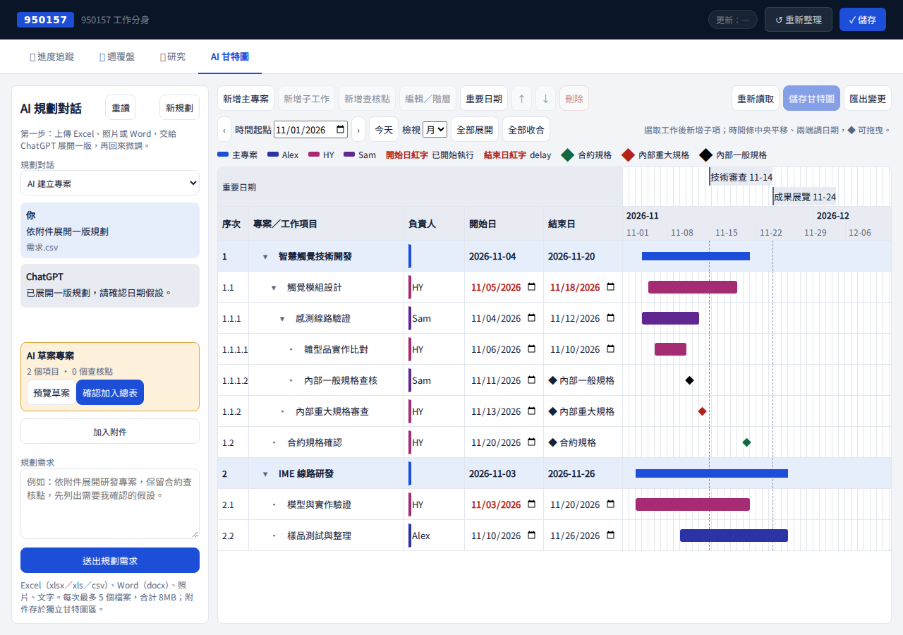
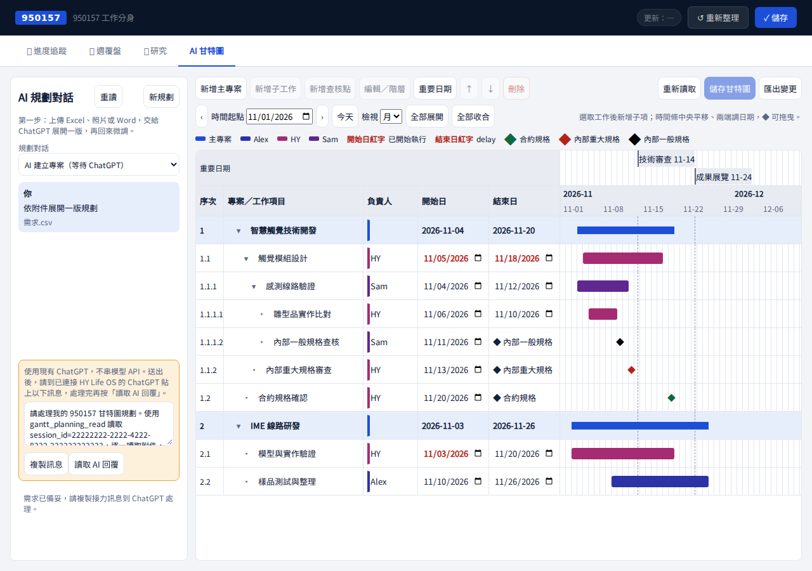
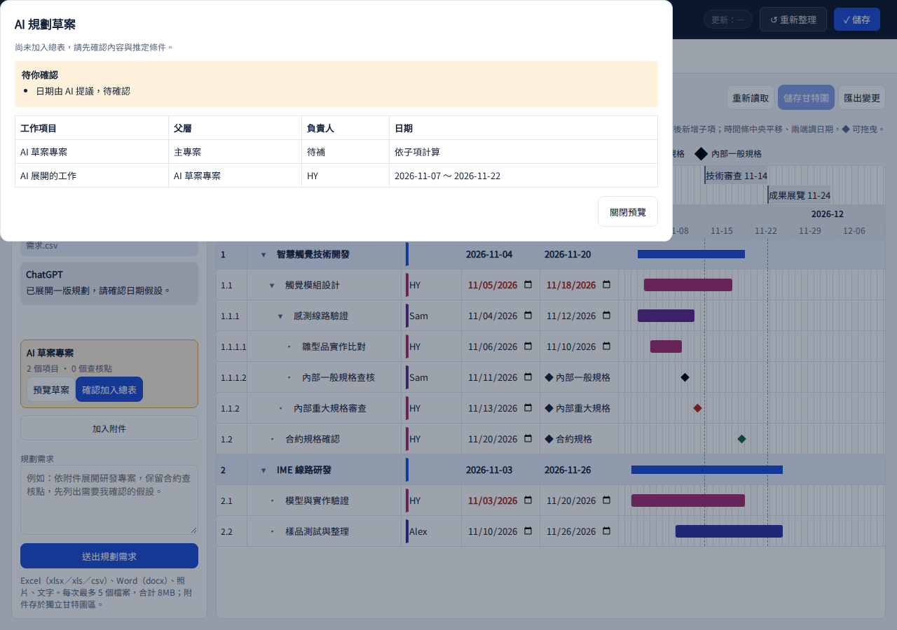

# 950157 甘特圖：AI 建案接力與重要日期

## 使用者本輪要求與畫面規劃

主要工作：先把 Excel、照片或計畫書交給 ChatGPT 展開一版新專案，再確認加入總表並微調。唯一焦點是「規劃草案 → 確認加入」，不是一開始要求使用者逐筆手動建案。

桌面採左側 280px AI 規劃對話、右側原總表。既有頁首與四個分頁不變，無外層導航、重複網站標題。沿用 hy-ui token、hy-btn、灰／藍／琥珀狀態；新元件是附件區、對話氣泡、草案預覽、重要日期參考線。原「已讀取獨立甘特圖…」常駐說明移除；載入／儲存通知以輔助技術讀取，只有錯誤才佔畫面空間。

使用者要求本輪先不處理手機版；本輪驗收與 CI 聚焦 1280px／1760px 桌面，不宣稱新版手機版已驗收。

## 不串模型 API 的實際流程

1. 左側輸入需求、加入附件，按「送出規劃需求」。
2. 複製畫面提供的接力訊息，到已連接 HY Life OS 的 ChatGPT 貼上。
3. ChatGPT 用目前訂閱模型分析附件、提出規劃；網站不呼叫模型 API，也不在背景自行執行模型。
4. 回網頁按「讀取 AI 回覆」或「重讀」，可繼續對話修訂，或開「預覽草案」查看工作、父層、負責人、日期與待確認假設。
5. 按「確認加入總表」才正式新增一個專案。既有專案不被取代；總表有未儲存變更時禁止套用。之後直接手動微調。

這是與現有 Slide Studio 同類的訂閱模型接力方式，僅沿用 MCP 驗證及傳輸模式。所有甘特圖請求、附件與草案獨立儲存，不讀取或修改 Slide Studio／Bot Office／原 950157 業務資料。新增 MCP 工具為 gantt_planning_list／gantt_planning_read／gantt_planning_respond；首次部署後若 ChatGPT 找不到工具，需更新 HY Life OS 連線的工具清單。

## 檔案與邊界

- 支援 Excel：xlsx／xls／csv；Word：docx；照片：png／jpg／jpeg／webp；文字：txt／md。
- 每次最多 5 個檔案，合計 8MB。Excel 讀取儲存的值與日期，保留非黑白字色與縮排提示；不執行巨集或公式。Word 讀取本文與表格文字，內嵌照片需另傳圖片。舊 doc 請另存 docx。
- 長文擷取至 100,000 字並標示截短；照片縮圖保留給 ChatGPT 視覺分析，非使用程式假裝 OCR／AI 規劃。
- 每段對話最多 30 則、每個草案最多 200 項；本階段只規劃一個新主專案，不用 AI 直接改寫已加入總表的專案。
- 假設日期與負責人需列出供人類確認。重試不重複新增，且不覆寫已套用後的人類微調。

## 檢視與重要日期

- 日／週／月：日為 48px／天、14 天；週為 30px／天、28 天；月為 9px／天、93 天，可改起點與前後期間，拖曳皆按天同步。
- 「重要日期」可新增、編輯、刪除展覽／審查／其他日期。名稱及日期顯示在時間軸上方，垂直虛線穿越所有專案。
- 共用重要日期不使用三色菱形；合約／內部重大／內部一般規格查核點維持綠／紅／黑 ◆。
- 已開始執行的開始日紅字、delay 的結束日紅字維持不變。主專案統一色，工作依負責人色。

## 驗證

- 前端全部單測：123 通過。
- Playwright／Chromium 桌面驗收：保留既有四種拖曳、階層、日期紅字、錯誤處理、原分頁測試；新增日檢視、重要日期管理與所有列參考線、附件接力、草案預覽、人類確認追加專案。
- 後端相關驗收：47 通過（解析真實 XLS／XLSX、Word XML、PNG／CSV、MCP 圖片、登入／工具權限、版本衝突、提案不寫總表、舊用戶端保留重要日期、套用重試保留人工修改）。
- GUI 的 ChatGPT 回覆為隔離 mock，用於驗證傳輸與套用流程；沒有呼叫付費模型或寫入正式資料。實際訂閱模型規劃品質須部署、更新工具清單後，由 ChatGPT 接力驗收。
- 截圖檢查後調整了左欄資訊分組、移除成功訊息的畫面佔位，並補充 Excel 字色提示與接力訊息；最終畫面見下。

